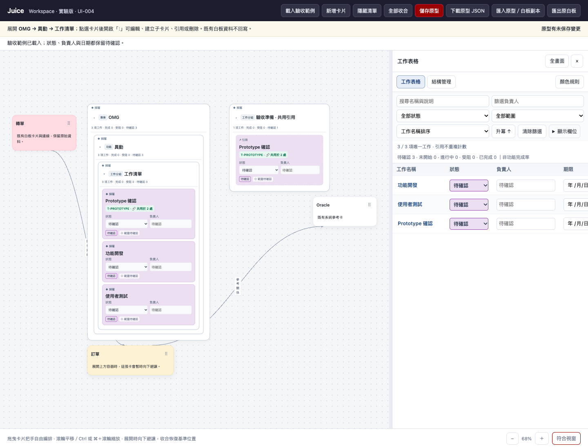
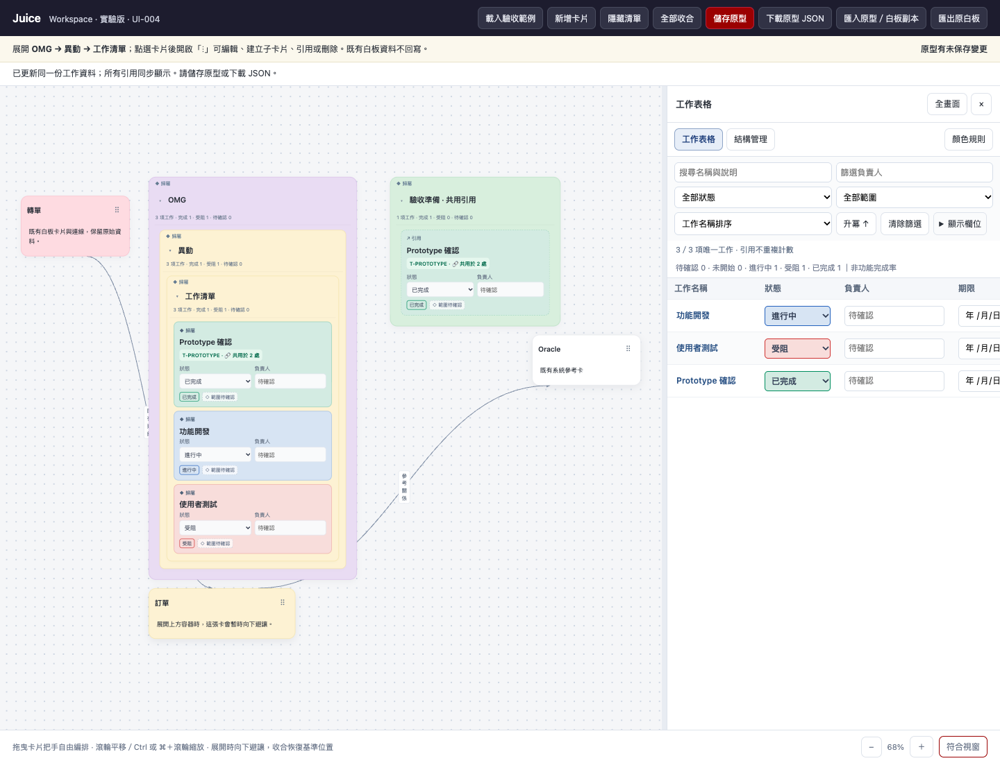

# JUICE-UI-004｜Workspace 資料檢視與視覺優化

本機 UI-004 與配色簡化增量，最新分支 `codex/workspace-simple-colors`，延續 UI-004 的 `bda73a4`。未推送、未合併、未部署。入口仍是 `nested-cards.html`；原 Classic 入口 `index.html` 不變。

## 本版變更

- 右側只保留「工作表格」與「結構管理」。首次開啟預設工作表格；已有存檔時保留使用者上次選擇。篩選、排序、欄位設定、直接編輯、定位、調寬與全畫面均沿用 UI-003。
- 工作卡現在整卡使用柔和狀態底色，不再依賴細色條。只有 `type: task` 的葉節點套用；容器的專案／功能／工作分組與傳統卡片維持原色。
- 工作卡、工作表格狀態選項與卡面狀態標記共用同一 `--status-color`，混入 82% 白色產生柔和底色。文字維持深色，即使自訂白色規則也可閱讀。
- 工作原本的手動 `color` 值仍完整保存在資料中，但本版畫面以狀態底色為優先；選單標示「備用手動色」，避免誤以為選色沒有作用。容器手動色照常立即顯示。
- 同一工作仍只有一個物件，所有引用同步；工作統計不重複計算，父卡彙整不等於功能完成率。

預設規則仍在 `assets/nested-color-rules.js`；「顏色規則」可編輯名稱／色碼、匯入及匯出獨立規則 JSON。設定隨原型保存，沒有新增或遷移資料模型。

## 配色簡化補充

- 新容器與新驗收範例預設中性白。舊檔的手動色值保留，不自動洗成白色。
- 容器外框固定灰色，不再跟底色推算，因此純白底仍有可見邊界。層級依縮排、間距與中性的用途標籤區分；引用仍用虛線／↗，選取仍用藍框。
- 建立卡片不再要求選色。容器選單提供「自動 · 中性白／柔灰／淡藍／淡黃」，原有或自訂色可從「進階自訂色」調整。
- 工作卡不再顯示無效的手動選色入口，只說明依狀態自動配色，並提供開啟共用狀態規則的按鈕；舊工作手動色仍保留在 JSON。

## 驗收與畫面

本機開啟 `http://127.0.0.1:4200/nested-cards.html?ui=004`。另有隔離視覺驗收入口 `http://127.0.0.1:4210/nested-cards.html?ui=004`，需在該連接埠啟動本專案的 HTTP 服務。

1. 展開 OMG → 異動 → 工作清單，並展開驗收準備看相同工作的引用。
2. 從工作表格切換狀態，確認兩處工作整卡底色同步，而容器不變色。
3. 切換結構管理，核對階層、主要歸屬、引用與 ID；切回工作表格仍只計一筆工作。
4. 調整顏色規則、儲存原型、重新整理，並下載／匯入原型 JSON，核對顏色與資料。

截圖中的完成／進行中／受阻是視覺驗收示意，不代表 OMG 實際狀態；示意使用 4210 的獨立瀏覽器來源，未修改 4200 或正式站的使用者資料。一般新範例仍全部待確認。

## 隔離與後續共用

不改 `assets/app.js`、`assets/core.js`、`assets/styles.css` 或 `index.html`。配色簡化只在 nested-core 調整新物件與範例的預設色，不變更資料格式。Workspace 仍用 `juice-nested-prototype-v1`，不存入 Classic 的 localStorage、IndexedDB 或 Drive。原始白板副本可原樣匯出；本次未新增流程圖、圖片或連線功能。

後續整合先評估抽出純顯示的卡片外框、色票與狀態標記、座標工具，以及已有的安全內容清理／資料驗證元件。不要複製 Classic 的編輯器、同步與歷史管理閉包；須先建立相容測試再共用，這一版不做該重構。

## 測試結果｜2026-10-25

- `npm run check` 通過。
- `npm run test:nested`：26 項資料單元測試、36 項 Workspace 介面測試全部通過。
- `npm run test:regression`：139 通過、1 失敗；失敗仍為既有 `tests/whiteboard.spec.cjs:194` 剪貼簿貼圖未產生 `.imgobj.below`，未修改該功能或繞過測試。
- 新增驗證包括五種狀態整卡著色、表格標記顏色一致、容器與傳統卡片完全不改色、自訂規則匯入、保存重載與完整原型往返，以及白色規則下的文字可讀性。

配色簡化增量：語法檢查通過，資料單元 27／27、Workspace 介面 38／38 通過；全站回歸 141 通過、1 個相同剪貼簿貼圖案例失敗。新增涵蓋純白底固定灰框、有限預設色、進階調色盤預設隱藏、新建容器中性白與舊色值不被覆寫。
