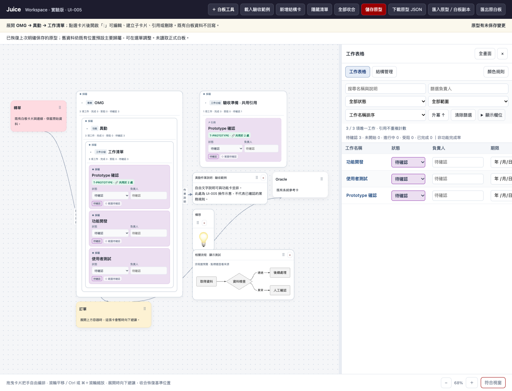

# JUICE-UI-005｜原生白板能力的 Workspace 本機原型

分支 `codex/juice-ui-005-native-workspace`，延續 `2d3a63c`。未推送、未合併 main、未部署。Classic 仍是獨立的 `index.html`；Workspace 入口 `nested-cards.html?ui=005`。

## 先評估，再整合

| 元件 | 本版做法 |
|---|---|
| 原始白板格式、安全文字與圖片 | 直接共用 `JuiceCore.normalize／sanitize` 與既有唯讀預覽；不改 Classic 程式。上傳以既有圖片驗證規則檢查來源。 |
| 工作／容器、引用與資料表 | 沿用 nested-core／nested-views，不另建工作資料、不更換既有 ID。 |
| 畫布拖曳、縮放、邊界定位與避讓 | 把新自由物件註冊到 Workspace 既有 items／positions；共用現有拖曳、實際尺寸量測與 layout，不另開第二張畫布。 |
| 流程圖 | 直接共用 `JuicePeleFlow.TEMPLATE／decode／draw`、Pele 與安全 SVG 清理，不自製流程解析器。 |
| Classic 富文字、工具列、歷史與圖片壓縮 | 綁在 app.js 的內部狀態，直接搬入涉及大重構，本次暫緩。只做純文字／備註的小型編輯介面與檔案讀取接合。 |

## 三階段交付

1. 一般文字卡、備註、圖片、少量通用圖示、上傳自訂圖示，以及取用匯入白板的既有自訂圖示庫。一般卡只有標題、文字與寬度，不要求工作類型、狀態或負責人。
2. 自由物件與結構物件／原白板卡片間的連線、單向／雙向／無箭頭、連線標籤與管理；沿用拖曳、鍵盤方向鍵、畫布縮放、寬度調整及自由物件的水平／垂直排列。
3. 既有流程文字的安全顯示、引用匯入白板中的 diagram 區塊，以及引用 Workspace 另一個流程原文。引用僅存來源 ID；改來源後各引用同步重畫。

## 操作驗收

本機 `http://127.0.0.1:4200/nested-cards.html?ui=005`，隔離示例可使用 4210。啟動方式仍是專案根目錄的 `python3 -m http.server 4200 --bind 127.0.0.1`。

1. 展開 OMG → 異動 → 工作清單。點「異動」選取後，開啟 **＋ 白板工具 → 一般文字卡**，輸入說明。新物件優先放在選取根容器旁的空位；也可用把手自由拖動。
2. 同一工具選單加入圖片或圖示。點自由物件標題可改內容／顯示寬度；圖片按比例調整顯示，內嵌原圖不重新壓縮。
3. 選 **建立連線**，以「結構卡 · 異動」為起點、新說明卡為終點，設定箭頭與說明。**管理自由物件** 可修改或刪除既有連線。
4. 選 **流程圖顯示／引用**。有匯入流程圖時直接選來源；也可貼上既有 Mermaid 原文或顯示共用範例。未載入 Pele／解析失敗時，保留可捲動的原文，不默默隱藏資料。
5. 在工作表格改狀態，核對所有工作引用仍同步。自由卡與圖示不計入工作統計。
6. 收合／展開結構卡，核對周邊自由物件避讓與復位。結構連線以穩定物件 ID 保存，收合時連到可見上層，展開後回到實際物件。若端點尚未放置，顯示提示而不刪除關係。
7. 按 **儲存原型**、重新整理、下載原型 JSON 並重新匯入，核對自由物件、原始副本、引用、座標與連線。

## 資料隔離

沿用 `juice-nested-board` version 1，新增可選 `native: {version:1,items:[],links:[]}`。原有 `objects／memberships／placements／primary` 不更換；沒有 native 的舊檔仍可讀取，開啟時不憑空建立自由物件。

- `native.items` 是新建自由卡、備註、圖片、圖示與流程圖的唯一資料；各有穩定 ID、位置與尺寸。純文字以 textContent 顯示，不執行 HTML。
- `native.links` 的端點使用具種類的 ID：結構物件、自由物件、原白板卡片。不把 DOM 座標當作關係。
- 流程引用指向本機原始白板副本的卡片／區塊 ID，或 native 流程 ID；不是連回 Classic／Drive 的跨應用即時同步。循環、失效引用拒絕載入；尚有流程引用時不可直接刪掉來源。
- `board` 原始副本保持原樣。**匯出原白板** 只輸出 board，不含本版新增內容；要完整交接，使用 **下載原型 JSON**。
- 只在明確保存時寫入 `juice-nested-prototype-v1`，不讀寫 Classic localStorage、IndexedDB 或 Google Drive。刪除結構物件會清除指向它的 native 連線；移除單一引用不刪除物件或其關係。

請用 UI-005 或更新版本編輯含 native 的檔案；舊 Workspace 頁面不提供這些自由物件的管理能力。原型 JSON 不可匯入正式 Classic 覆蓋正式資料。

## 暫緩與限制

- 不重寫或載入 Classic 的大型 app.js。完整富文字區塊、剪貼簿貼圖、圖片壓縮／裁切／圖層工具列、群組拖曳、框選、完整 undo／redo、Flow Plus 編輯器、Drive 同步仍暫緩。
- 匯入來源仍唯讀；原卡可拖動位置覆層、查看完整內容並作為連線／流程引用來源，但不在此原型編輯原始區塊。來源圖片／備註／圖示可參與暫時避讓，不提供全部 Classic 編輯控制。
- 內建圖示先採少量通用符號，自訂圖示可上傳或取用既有圖示庫；完整 Classic SVG 圖示註冊表尚未抽成共用元件。
- 流程圖採安全標準預覽；保留 Flow Plus metadata 與 diagramPositions，但尚未啟用其自訂編輯器或保證完全重現其手動布局。
- 沒有穩定區塊 ID 的舊流程仍可從來源卡查看，但不提供不穩定的區塊引用；不偷偷改寫來源補 ID。
- 連線先用明確起終點選擇，不做拖曳連線端點或避障路由；同一結構物件優先連到主要歸屬位置，收合則連可見上層。最多顯示／解析 500 個結構位置的既有限制仍適用。
- 新自由物件最多 150，native 連線最多 300；上傳每檔 5 MB，僅 PNG／JPEG／WebP／GIF；原型整體仍 20 MB。超限拒絕套用，不截掉內容。

## 測試

`npm run check`、`npm run test:nested`、`npm run test:regression`。新增資料測試覆蓋原始副本不變、自由物件 ID、跨類型端點、刪除清理、循環與來源引用；新增介面測試覆蓋圖片／自訂圖示、縮放尺寸、箭頭、避讓、原地編輯、流程安全預覽、來源同步與原型往返。

2026-10-25 驗證：語法檢查通過；資料單元 35／35、Workspace 介面 48／48 通過。全站回歸 151 通過、1 失敗，仍為 `tests/whiteboard.spec.cjs:194` 的既有剪貼簿貼圖案例未生成 `.imgobj.below`；未修改正式白板或繞過此測試。

實際瀏覽器也已確認 Pele SVG 預覽、功能卡至自由說明卡的箭頭，以及原型保存後重載。範例文字僅為操作示意，不視為已確認的 OMG 規則。

