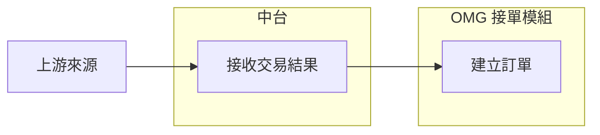

# 流程圖表單編輯

開啟流程圖編輯器後，按「圖形拖拉工具」。在「步驟」中修改名稱與類型，在「連線與條件」中選取起點、終點與條件文字。圖上的節點可拖曳；雙擊節點會定位名稱欄位。新增或刪除步驟時，文字與圖形使用同一份資料模型更新。

流程文字保存在 diagram block 的 html；編輯座標保存在可選 diagramPositions 字串，不增加資料版本。舊的 juice-positions 註解仍可讀取，下一次編輯會將它移到獨立欄位。左側文字輸入會重新解析成模型；表單變更以模型產生 Mermaid。支援 LR/RL/TD/TB/BT、矩形／判斷／圓角節點、箭頭、虛線、條件標籤及連續連線。style/classDef/class 行會保留。

編輯器預設開啟可操作圖形。雙擊或右鍵節點可就地改字；節點旁可切換類型、連線或新增下一步。新增下一步會自動接上箭頭。自動排列重新配置編輯座標；Pele 排版預覽則根據流程文字自動排版，不保證相同節點位置。「匯出文字」下載乾淨的 flowchart.mmd，不包含編輯座標。

雙擊／右鍵節點現會開啟完整設定視窗，包含名稱、自訂編碼、形狀及該節點的輸出連線／條件／虛線設定。編碼須以英文字母或底線開頭，後接英數字或底線，最長 64 字，不得重複或使用語法保留字。改碼會同步更新連線及樣式參照。「產生短碼」可用 S1 等編碼取代舊長碼；「整理長編碼」只處理舊版產生的 N 加長十六進位碼。步驟清單預設收起，可按工具列按鈕展開。

支援六種節點：矩形、菱形、圓角、圓形、資料庫圓柱及子程序。新增三種形狀以 Pele 1.9.0 實際渲染驗證。

未支援語法會顯示提示並停用表單寫入，原始文字仍可編輯；不會以不完整模型覆蓋原文。其他圖表類型尚未提供專用表單。Pele 預覽使用自動排版，圖形編輯畫布的位置保存在座標註解。

## 泳道／系統群組

可在圖形拖拉工具按「＋ 泳道」，在步驟清單修改泳道名稱或刪除泳道。刪除泳道會把其中節點移到泳道外，不會刪除步驟與連線。雙擊／右鍵節點後，在「所屬泳道」選擇群組或「泳道外／上游來源」；新增下一步會沿用目前節點的泳道。圖形畫布以帶標題的背景顯示泳道，自動排列依泳道分組；手動拖曳座標仍保存在 `diagramPositions`。Pele 預覽會重新排版，因此兩邊的位置不一定相同。

泳道文字採一層 Mermaid `subgraph SYSTEM_ID [系統名稱]`，各泳道的節點放在群組內，連線放在群組外，包含跨系統箭頭。泳道外的節點保留在群組外。範例：

舊流程沒有泳道時，仍照原方式解析與輸出，不會自動改寫成 `subgraph`。只支援單層、固定編碼與名稱的簡單群組；巢狀 `subgraph`、未知語法，以及泳道與手動 `style`／`class` 混用時，圖形／表單寫入會停用並保留原文，請改用文字編輯或先另存一份。文字匯出只包含 Mermaid，不帶手動座標。

圖形拖拉工具使用保存的手動座標；白板卡片及 Pele 排版預覽則從 Mermaid 文字重新計算位置，因此兩者的節點位置與連線彎曲方式可能不同。Pele 預覽會替簡單泳道套用與編輯器相近的綠／藍配色，判斷與開始／結束節點也會顯示淡色。這些顏色只影響 Juice 內的顯示，不寫入匯出的 `.mmd`；原始 Mermaid 已手動指定的泳道或節點顏色優先保留。

主要程式：assets/flow-builder.js。parse、serialize 與 mount 共用節點／連線模型。測試位於 tests/whiteboard.spec.cjs，包含語意往返、表單同步與未支援語法保護。
