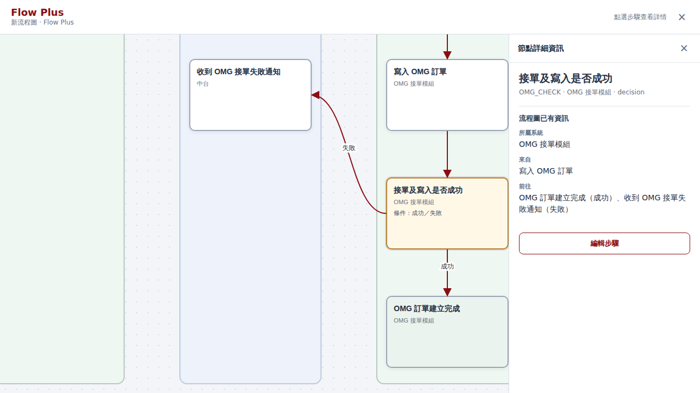

# Flow Plus Phase 1

Flow Plus 是 Juice 白板中的進階流程工作區。它以現有 Mermaid 文字保存節點、泳道與連線，並在同一張流程卡的 `diagram` 區塊 `aiContext` JSON 中保存結構化節點詳情。白板仍使用 `schemaVersion: 3`；不新增後端或資料欄位。Classic 的編輯器和既有流程資料不會被轉換。

從「更多工具」選「Flow Plus」可建立新工作區。既有流程則在 Classic 編輯器選「建立 Flow Plus 副本」；副本保留原有 Mermaid、節點編碼、泳道和連線，原圖留在白板上。若原文包含 Flow Builder 尚未支援的 Mermaid 語法，轉入會停止並顯示原因，不產生可能遺失連線的副本。

Flow Plus 顯示所有節點、條件標籤與跨泳道箭頭。節點卡片只顯示名稱、系統，以及已有的重要條件或結果。點選節點後，右側面板先以閱讀模式呈現流程圖已有的泳道、前後連線與分支條件，以及已填的說明和詳細資料；空欄位不顯示。選「編輯步驟」時，先只看到步驟名稱與自然語言作業說明；「結構化欄位」可按需展開，編輯執行者、觸發、條件、動作、輸入、輸出、結果及原有其他欄位。手機版將詳情面板改為底部抽屜。

`aiContext` 的 `flowPlus.version` 為 1，`flowPlus.nodes` 以既有節點 ID 為鍵。每筆節點含 `id`、`step`、`name`、`type`、`lane`、`stageId`、`actor`、`trigger`、`conditions`、`actions`、`inputs`、`outputs`、`effects`、`notes`、`questions`、`source`。`id`、`type`、`lane` 與連線由 Mermaid 提供；修改名稱會同步寫回 Mermaid 與結構化資料，不改節點 ID 或連線。流程圖中的條件與連線僅供自動顯示，不寫入空白結構化欄位，避免產生過期副本。未確認的業務規則留空，既有待確認事項保留並呈現。整段 `aiContext` 上限為 50,000 字元，由既有 normalize 規則驗證。

圖形使用 `JuiceFlowBuilder.parse` 的共同模型，Flow Plus 只負責自己的閱讀畫面與詳情表單。Mermaid 原文仍可交給 Pele 顯示於白板卡片。AI 整理的入口與確認流程留待下一階段，目前沒有無效的 AI 按鈕。Phase 1 預設完整展開；階段收合、路徑高亮、Flow Plus 中直接改連線，以及任意 Mermaid 語法的無損轉入留待後續實作。舊版 Juice 雖能保存這張卡的 Mermaid 與 `aiContext`，仍應使用新版工作區編輯 Flow Plus 詳情。
