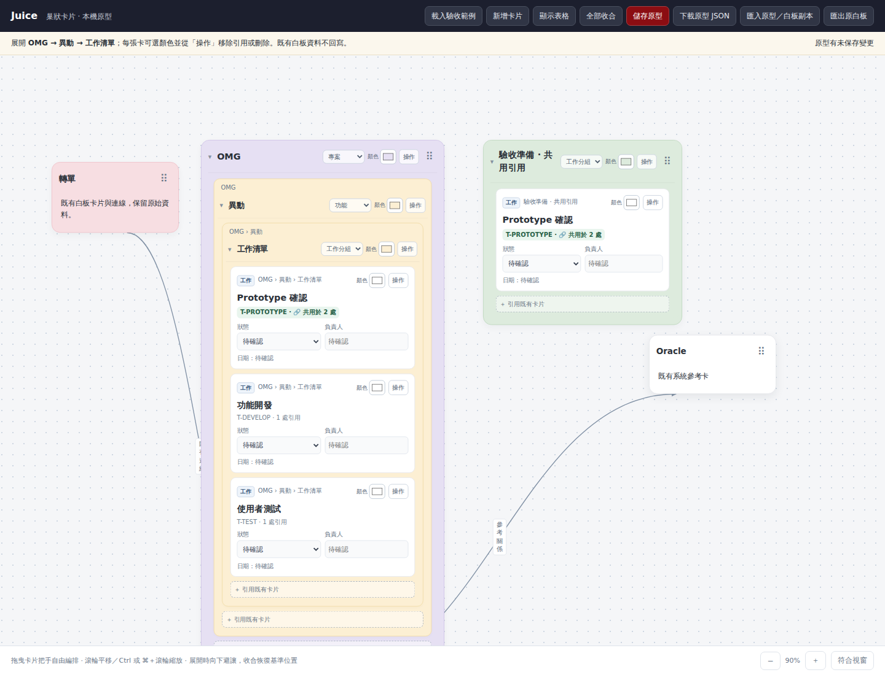
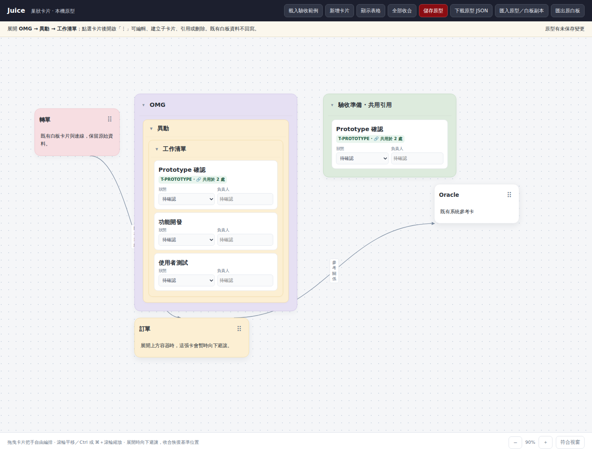
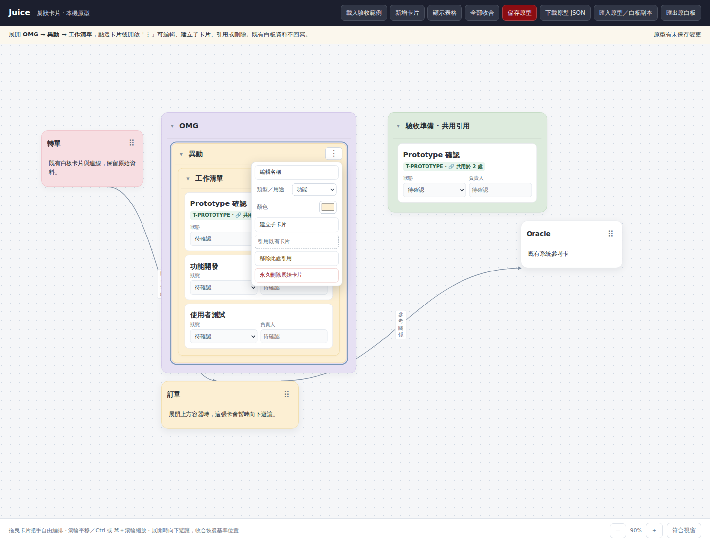

# JUICE-UI-002 卡片操作介面比較

同一份 OMG → 異動 → 工作清單 → 工作卡範例，視窗 1440 × 1100，縮放 90%。圖片中的工作狀態與負責人仍為「待確認」。

| 修改前：控制項常駐 | 修改後：閱讀狀態 |
| --- | --- |
|  |  |

點選容器名稱或卡面後，單一「⋮」選單提供改名、類型／用途、顏色、建立子卡片、引用、移除此處引用及永久刪除原始卡片。展開箭頭可直接操作，不會選取卡片。

變更只在巢狀卡片原型頁；原白板、Classic、Flow Plus 與儲存格式未改。工作卡的狀態與負責人保留快速編輯。選單的「類型／用途」是既有容器用途（一般容器、專案、功能、工作分組），工作卡與容器卡的資料種類仍在建立時選擇。
